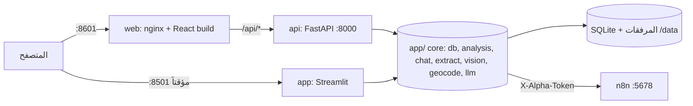

# خطة بناء واجهة Alpha الجديدة بـ React مع API

## الفكرة باختصار
نبني واجهة جديدة بـ React حسب **التصميم 2 (النتائج جنب القضية)**، وصفحة «قضية جديدة» حسب **الاقتراح 2 (داخل مساحة النتائج)**، وشاشات الموبايل الأربع.
الواجهة بتحكي مع **API جديد بـ FastAPI**، وهو بيستخدم نفس كود التحليل وقاعدة البيانات الموجودين بـ `app/` (`db.py`، `analysis.py`، `chat.py`، `extract.py`، `vision.py`، `geocode.py`، `llm.py`، `attachments.py`) بدون ما نعيد كتابتهم.
Streamlit بيضل شغّال على 8501 لحد ما الجديد يكتمل، والاثنين على نفس البيانات. بعد الاكتمال بنشيله بخطوة منفصلة بموافقتك.

مرجع التصاميم: [.kombai/canvas/alpha-react-redesign.canvas](.kombai/canvas/alpha-react-redesign.canvas)

| الشاشة | العقدة |
|---|---|
| النتائج + القضية (التقرير) | `var_b91e9b2f057d` |
| المصادر + المحادثة | `var_debcc9c58e33` |
| قضية جديدة (المعتمد) | `var_acd4229aab0b` |
| موبايل: النتائج / القضية / المحادثة / المصادر | `var_7ed388f388a8` / `var_36861e276b5f` / `var_de537aec0e08` / `var_312690d00690` |
| السجل الكامل قبل اختيار قضية (من التصميم 1، بنستخدم الجدول بس) | `var_4d4cc1565931` |

---

## المعمارية



```
AlphaSystem2/
├── app/            # كما هو (Streamlit + الكود الأساسي)
├── api/            # جديد: FastAPI
│   ├── main.py            # إنشاء التطبيق، /api، الأخطاء، CORS للتطوير بس
│   ├── deps.py            # اللغة من ?lang أو Accept-Language
│   ├── schemas.py         # نماذج Pydantic للطلب والرد
│   ├── uploads.py         # محوّل UploadFile → واجهة attachments.save
│   └── routes/
│       ├── cases.py  attachments.py  messages.py  meta.py
├── web/            # جديد: Vite + React + TS
└── tests/          # + test_api_*.py
```

**ملاحظة:** الـ API بيضيف `app/` على `sys.path` (بالضبط زي `tests/conftest.py`). فما بننقل ملفات خلال فترة التعايش. بعد ما نشيل Streamlit منقدر نغيّر اسمه لـ `core/`.

---

## المرحلة 0: تجهيز الكود الأساسي للتعايش
| التغيير | الملف | السبب |
|---|---|---|
| `PRAGMA journal_mode=WAL` وقت `init_db` | `app/db.py` | عمليتين (Streamlit وAPI) بيكتبوا على نفس SQLite |
| عمود `worker TEXT` بـ `investigations` و`messages`، يتعبّى وقت `start_analysis`/`ask`/`retry` | `app/db.py`، `app/analysis.py`، `app/chat.py` | `fail_interrupted` وقت إعادة التشغيل لازم يفشّل بس الشغل اللي بدأته نفس الخدمة. هيك إعادة تشغيل Streamlit ما بتقتل تحليل شغّال بالـ API |
| `fail_interrupted(error, worker)` بياخد اسم الخدمة (`streamlit` أو `api`) من `ALPHA_WORKER` | `app/db.py`، `app/config.py` | نفس السبب |
| `attachments.save` بيقبل أي كائن فيه `name`/`type`/`getvalue()`؛ بنعمل محوّل بسيط للـ API | `api/uploads.py` | ما بنغيّر منطق الحفظ |
| اختبارات للتغييرات الثلاثة | `tests/test_db.py` | |

---

## المرحلة 1: الـ API (FastAPI)
المكتبات (بنضيفها لـ `requirements.txt`): `fastapi`، `python-multipart`. `uvicorn` موجودة أصلاً.
كل الأخطاء بترجع `{error: {code, message}}`، والرسالة بلغة الطلب من `i18n.t`.

| الطريقة | المسار | شو بتعمل (الدالة الموجودة) |
|---|---|---|
| GET | `/api/health` | `analysis.check_n8n` → `{level, message}` |
| GET | `/api/meta` | التصنيفات والحالات والخطورة وحجم المرفق الأقصى |
| GET | `/api/samples?lang=` | `samples.SAMPLES` |
| GET | `/api/cases?q&type&status&severity` | `db.list_cases` + `db.stats` + `db.attachment_counts`، وبيشغّل `analysis.locate_missing` بالخلفية |
| GET | `/api/cases/export.csv` | `db.export_cases_csv` |
| POST | `/api/cases` | `{case_text}` → `db.create_draft` + `db.next_case_number` |
| GET | `/api/cases/{id}` | الحقول + `report` (من `parse_report`) + `report_raw` + الإصدارات + المرفقات + عدد الرسائل |
| PATCH | `/api/cases/{id}` | `db.update_case` (الحقول المسموحة بس) + `analysis.locate` + تحذير الرقم المكرر |
| POST | `/api/cases/{id}/suggest` | `analysis.suggest_details` + `geocode.find` للموقع المقترح |
| POST | `/api/cases/{id}/analyze` | `analysis.start_analysis` → 202 |
| DELETE | `/api/cases/{id}` | `attachments.remove_for_case` + `db.delete_case` |
| GET | `/api/cases/{id}/versions/{vid}` | نسخة سابقة من التقرير |
| GET | `/api/cases/{id}/report.txt?version=` | `analysis.report_as_text` (التنزيل بيحدد النسخة) |
| GET | `/api/cases/{id}/attachments` | `db.list_case_files`، مع حالة القراءة لكل ملف |
| POST | `/api/cases/{id}/attachments` | رفع عدة ملفات (multipart) → `attachments.save` |
| GET | `/api/attachments/{aid}/file` | `FileResponse` مع دعم Range لتشغيل الفيديو |
| DELETE | `/api/attachments/{aid}` | `attachments.remove` |
| POST | `/api/cases/{id}/attachments/read-preview` | «اعرض ما سيقرأه التحليل»: `extract.describe` + `vision.describe_many` |
| GET | `/api/cases/{id}/messages` | `db.list_messages` + مرفقات كل رسالة |
| POST | `/api/cases/{id}/messages` | نص + ملفات → `chat.ask` → 202 |
| POST | `/api/messages/{mid}/retry` | `chat.retry` |
| POST | `/api/messages/{mid}/update-report` | `chat.update_report` |
| DELETE | `/api/cases/{id}/messages` | `chat.clear` |
| GET | `/api/geocode?q=` | `geocode.find` (لما تكتب الموقع يدوياً) |

**متابعة التحليل والرد:** الواجهة بتعيد طلب `GET /api/cases/{id}` كل 3 ثواني، بس وهي الحالة `analyzing` أو في رد `pending`، عن طريق `refetchInterval` بـ TanStack Query. ما في WebSocket بهالمرحلة.
**الحماية:** الـ API مربوط على `127.0.0.1` بس، زي باقي الخدمات. الـ token تبع n8n بيضل بالخادم وما بيوصل للمتصفح.
**الاختبارات:** `tests/test_api_cases.py`، `test_api_attachments.py`، `test_api_messages.py` باستخدام `fastapi.testclient`. بتستخدم نفس fixtures القاعدة المؤقتة، وكل الشبكة فيها مستبدلة بمحاكاة.

---

## المرحلة 2: هيكل الواجهة (`web/`)
**الأدوات:** Vite + React 19 + TypeScript، Tailwind v4 (`@tailwindcss/vite`)، Radix (`dropdown-menu`، `dialog`، `alert-dialog`، `select`، `tabs`، `popover`، `toast`، `visually-hidden`)، `@tanstack/react-query`، `react-router` (data router عشان `useBlocker` وزر الرجوع)، `react-leaflet` + `leaflet` + `leaflet.markercluster`، `@mdi/js` + `@mdi/react` (أيقونات SVG بدل خط الـ CDN)، `@fontsource/tajawal` (الخط محلي، ما في طلب لـ Google)، `vitest` + `@testing-library/react`.

**الرموز (`web/src/styles/tokens.css`)**، بقيم مأخوذة من `app/styles.css` والتصاميم:
```css
@theme {
  --color-ground:#040B1C; --color-bar:#030A19; --color-panel:#08142A; --color-soft:#0B1830;
  --color-ink:#EEF3FF; --color-ink-2:#C7D2EA; --color-muted:#93A3C2; --color-rule:#1B2A47;
  --color-blue:#0A6CFF; --color-blue-2:#2B8CFF; --color-blue-text:#6DB2FF;
  --color-accent:#FF6B4A; --color-amber:#F2B35C; --color-ok:#6EE7A8; --color-bubble-me:#0D2147;
  --font-sans:'Tajawal',sans-serif; --radius-field:12px; --radius-panel:16px;
  --shadow-primary:0 8px 28px rgba(10,108,255,.38);
}
```
وبنعمل كلاسات مشتركة للنصوص: `.h-page`، `.h-section`، `.text-meta`، `.ltr` (للأرقام والتواريخ).

**اللغة والاتجاه:** نقلنا `app/i18n.py` لـ `web/src/i18n/{ar,en}.ts` بنفس المفاتيح. في hook اسمه `useT()`، وكمان `dir`/`lang` على `<html>`. اللغة بتنحفظ بالرابط (`?lang=en`) وبـ `localStorage`. الجهات بتنكتب بخصائص منطقية (`ps-/pe-/ms-/start-`)، فالإنجليزي بيقلب لحاله.

**الروابط (كل حالة إلها رابط، فزر الرجوع بيشتغل):**
| الرابط | الشاشة |
|---|---|
| `/cases` | السجل الكامل (جدول) قبل ما تختار قضية |
| `/cases/:id` | النتائج + القضية (التقرير) |
| `/cases/:id/chat` | النتائج + المحادثة |
| `/cases/:id/sources` و `/cases/:id/chat/sources` | المصادر مكان النتائج (وبالموبايل شاشة كاملة) |
| `/cases/map` | خريطة النتائج نفسها |
| `/cases/new?step=1\|2` و `/cases/:id/edit?step=` | قضية جديدة / تعديل (الاقتراح 2) |
| `/about` | من أنا |

الفلاتر والبحث (`q`، `type`، `status`، `severity`) جزء من الرابط، وبتنتقل مع كل رابط داخلي. منها بنحسب «النتيجة 2 من 4» والسابقة/التالية، بالترتيب الحقيقي للنتائج.

**شجرة المكونات:**
```
App
├── AppShell (AppBar ثابت بكل الشاشات: الشعار، كل القضايا، من أنا، ServiceStatus، NewCaseButton، LanguageToggle | موبايل: MobileMenu)
├── RegisterPage (/cases): SummaryLine، SearchFilters، CasesTable (الصف كله رابط، دائماً «فتح القضية»)، TypeSummaryDisclosure
├── Workspace (/cases/:id…)
│   ├── ResultsPane: SearchFilters (مختصرة)، ActiveFilterChips، ResultList (العنصر المختار بخلفية + إطار + aria-current)، ResultsMapButton
│   │   └── أو SourcesInspector: OriginalReport، AttachmentList (AttachmentRow، UploadButton، ReadPreviewDialog)، LocationPreview (الخريطة ما بتتحمّل إلا لما تطلبها)
│   └── CasePane: CaseHeader (PrevNext، CaseActionsMenu، StatusPill، SeverityMark، FactLine)، ModeTabs (التقرير/المحادثة)
│       ├── ReportView: ReportToolbar (SectionsMenu، VersionSelect، DownloadReport، SourcesToggle)، ReportDocument (Summary، Timeline، EvidenceList، PartiesList، Hypotheses، NextSteps، GenericSection)، StatePanel (مسودة / قيد التحليل / فشل)
│       └── ConversationView: Transcript (MessageBubble، FileChip، PendingBubble، FailedMessage + إعادة المحاولة، UpdateReportButton)، UpdateConfirmation، Composer
├── CaseEditor (/cases/new، /:id/edit): Stepper، StepWhatHappened (Textarea، عدد الأحرف، SampleButton، TipsList)، StepDetails (DetailsGroup، LocationGroup + PinMap، AttachmentsGroup، OriginalReportDisclosure، SaveBar)، UnsavedChangesDialog
└── AboutPage (نقل صفحة «من أنا» مع الفيديو والروابط)
```
المكونات المشتركة بـ `web/src/components/ui/`: `Button` (`primary` | `secondary` | `ghost`، `size="sm|md"`)، `Field`، `SelectField` (Radix)، `Pill`، `Chip`، `Panel`، `Menu`، `ConfirmDialog`، `Toast`، `Icon`. المنطق بـ hooks: `useCases`، `useCase`، `useResultsContext`، `useCaseEditor`، `useUnsavedGuard`، `useLang`. والـ API calls بـ `web/src/api/client.ts` مع أنواع TS مطابقة لـ `schemas.py`.

---

## المرحلة 3: النتائج والسجل
- `RegisterPage`: الجدول والبحث والفلاتر. الفلترة بالواجهة فورية للبحث المكتوب (debounce 200ms، ثم طلب للخادم).
- `Workspace` بحالة القضية المختارة: قائمة النتائج بتضل ثابتة وما بيعاد تحميلها لما تتنقل بين القضايا. البيانات المسبقة لـ «السابقة» و«التالية» بتتحمّل بـ `queryClient.prefetchQuery`.
- القضية اللي ما عادت تطابق الفلاتر بعد تحديثها بتضل مفتوحة، ومعها رسالة «هذه القضية لم تعد تطابق الفلاتر».
- `/cases/map`: نفس النتائج على خريطة، مع ألوان الخطورة والحالة. بنعيد استخدام قواعد الألوان والـ cluster من `maps.py`، والأسماء بتنهرّب مثل `maps.safe_text`. الخريطة بتتحمّل بس لما تفتح هالشاشة (`React.lazy`).

## المرحلة 4: صفحة القضية (التقرير والمصادر)
- `ReportDocument` بيقرأ مفاتيح التقرير بنفس منطق `find_key` (ملخص، وقائع، أدلة، أطراف، خطورة، فرضيات، خطوات). الأقسام الثانية بتنعرض بالترتيب اللي رجع من التحليل. وإذا التقرير مش JSON بينعرض كنص.
- `VersionSelect`: اختيار نسخة سابقة بيبدّل المستند مكانه، مع شريط «تعرض نسخة سابقة» و«العودة إلى التقرير الحالي».
- `CaseActionsMenu`: تعديل، إعادة التحليل، تنزيل التقرير، حذف. الحذف بـ `AlertDialog` مكتوب فيه «حذف نهائي» و«إبقاء القضية».
- حالات القضية: مسودة («تحليل القضية» + «متابعة التعديل»)، قيد التحليل (التقرير السابق بيضل ظاهر مع رسالة)، فشل (زر إعادة واحد + تفاصيل الخطأ مطوية).
- `SourcesInspector`: المرفقات مع حالة القراءة الحقيقية («قُرئ في التحليل» إذا في وصف أو نص محفوظ، «سيُقرأ عند التحليل»، «لم يُقرأ: …»). المعاينة بتتحمّل بس لما تضغط عليها.

## المرحلة 5: المحادثة
- الرسائل بتتمرّر داخل مكانها، ومربع الكتابة ثابت تحت. بتنزل تلقائياً لآخر رسالة بس إذا كنت أصلاً قريب من الآخر، وإلا بيطلع زر «رد جديد».
- الإرسال فوري بالواجهة (optimistic)، والرد قيد الكتابة بيتابع بـ `refetchInterval`.
- «تحديث التقرير» → رسالة تأكيد ورابط «عرض التقرير»، بدون ما ينقلك لحاله.
- «مسح المحادثة» جوا قائمة خيارات المحادثة، مع تأكيد خاص فيه.
- المسودة اللي بتكتبها بتنحفظ لكل قضية لحالها (`sessionStorage`)، فما بتنتقل لقضية ثانية.

## المرحلة 6: قضية جديدة / تعديل (الاقتراح 2)
- النتائج بتضل جنب النموذج، ومعها «العودة إلى النتائج»، أو «العودة إلى القضية» وقت التعديل.
- **الخطوة 1:** نص البلاغ، عدد الأحرف (20 حرف حد أدنى)، «استخدم قضية نموذجية» (بيطلب تأكيد إذا رح يستبدل نص مكتوب)، والنصائح الأربع. «التالي» بيحفظ المسودة (`POST /api/cases`)، وبعدين `suggest`. وإذا فشل الاقتراح بيطلع «تعذّر اقتراح التفاصيل. يمكنك إدخالها يدوياً.»
- **الخطوة 2:**
  - مجموعة «تفاصيل القضية»: العنوان والتصنيف والرقم والتاريخ.
  - مجموعة «الموقع والمرفقات»: حقل الموقع مع خريطة صغيرة، و«تعديل الدبوس على خريطة أكبر» بـ Dialog.
  - «نص البلاغ الأصلي» قسم بينطوى، ومعه زر «تعديل».
  - شارة «مقترح من النص» على الحقول اللي تعبّت من الاقتراح بس.
- **الحفظ:**
  - «حفظ وتحليل القضية» و«حفظ كمسودة» بيرجعوك لنفس النتائج، مع رسالة.
  - إذا الفلاتر الحالية ما بتشمل القضية الجديدة: «حُفظت القضية، لكنها لا تطابق الفلاتر الحالية» مع «عرض القضية».
  - وقت التعديل: «حفظ التعديلات» بترجعك للقضية، و«حفظ وإعادة التحليل».
- **التغييرات غير المحفوظة:** `useBlocker` من React Router + `beforeunload`. النافذة بتسمّي الوجهة، وبتوضح إن المسودة المحفوظة والمرفقات المرفوعة بتضل.

## المرحلة 7: صفحة «من أنا»
نقل `render_about` بنفس المحتوى: الفيديو `app/assets/about-video-user.mp4` مع البوستر، أزرار التحكم بالفيديو، روابط واتساب وجيت هب والبريد، والمزايا الأربع. الفيديو بيتحمّل بس لما تفتح الصفحة.

## المرحلة 8: الموبايل والإنجليزي
- تحت 768px: النتائج شاشة، والقضية شاشة، والمصادر شاشة كاملة، والمحادثة مربع الكتابة فيها ثابت ومحترم لوحة المفاتيح (`env(safe-area-inset-bottom)` و`visualViewport`).
- `MobileMenu` (Radix Dialog) فيه كل القضايا، من أنا، حالة الخدمة، واللغة.
- الفلاتر بالموبايل بتفتح بلوحة من تحت، مع عدد الفلاتر المفعّلة.
- مراجعة كل الشاشات بالإنجليزي من اليسار لليمين.

## المرحلة 9: Docker والتشغيل
- **`Dockerfile.api`:** `python:3.11-slim`، بينسخ `app/` و`api/`، وأمر التشغيل `uvicorn api.main:app --host 0.0.0.0 --port 8000`، ومعه `ALPHA_WORKER=api`.
- **`web/Dockerfile`:** بناء بـ `node:24-alpine`، وبعدين `nginx:alpine` بيخدم الملفات وبيمرّر `/api` لـ `api:8000` (`client_max_body_size 200m`).
- **`docker-compose.yml`:**
  - خدمتين جداد `api` و`web` على `127.0.0.1:${WEB_PORT:-8601}`.
  - نفس الـ volume `app_data` ونفس متغيرات `x-llm-env`.
  - `app` (Streamlit) بيضل كما هو مع `ALPHA_WORKER=streamlit`.
- **التطوير:** `npm run dev` بـ `web/` (Vite proxy لـ `/api` على `localhost:8000`)، و`uvicorn api.main:app --reload`.
- **الوثائق:** نحدّث `run_alpha.bat`/`.sh` ليفتحوا المنفذ الجديد، والـ README.

## المرحلة 10 (منفصلة وبموافقتك): شيل Streamlit
نشيل `app/main.py` و`ui.py` و`chat_ui.py` و`attachment_ui.py` و`maps.py` و`styles.css` واختبارات `test_app_ui.py`/`test_maps.py`، وخدمة `app` من compose، ونغيّر اسم `app/` لـ `core/`.

---

## السرعة: أهداف بنقيسها بعد البناء
| الحالة | Streamlit هلأ | الهدف |
|---|---|---|
| التنقل بين قضيتين من النتائج | 1.2 ث | أقل من 300 مللي ث، لأن البيانات محمّلة مسبقاً |
| تبديل التقرير ↔ المحادثة | 1.3 ث | فوري، بدون طلب للخادم |
| فتح قضية من السجل | 2.8 ث | تقريباً ثانية أو أقل |
| تبديل اللغة | 1.4 ث | فوري |
| زر الرجوع بالمتصفح | ما بيشتغل | بيرجع للصفحة السابقة مع فلاترها |

الطرق: تقسيم الكود حسب الصفحة (الخريطة، الفيديو، المحادثة)، قوائم بدون إعادة رسم غير لازمة (`memo`)، وأماكن محجوزة بنفس المقاس وقت التحميل حتى ما تقفز الصفحة. المعاينات والخرائط ما بتتحمّل إلا بطلب.

---

## تعريف الإنجاز
- [ ] الـ API بيغطي كل وظائف الموقع الحالي، ومعه اختبارات pytest ناجحة، والاختبارات القديمة الـ 331 ناجحة.
- [ ] كل الشاشات المعتمدة (ديسكتوب وموبايل، عربي وإنجليزي) مطابقة للتصاميم على اللوحة.
- [ ] زر الرجوع بالمتصفح والروابط المباشرة لكل قضية وتبويب بتشتغل، والفلاتر بتضل محفوظة.
- [ ] التحليل والمحادثة والمرفقات (رفع، معاينة، حذف) والتحديث من المحادثة بيشتغلوا من الواجهة الجديدة على نفس البيانات.
- [ ] `docker compose up -d --build --wait` بيشغّل الواجهة الجديدة على 8601 جنب Streamlit على 8501، وإعادة تشغيل وحدة ما بتفشّل تحليل الثانية.
- [ ] قياس السرعة بالمتصفح بيحقق الأهداف بالجدول أو بيوضح الفرق.


---
# To-dos (9)
- [ ] **تجهيز الكود الأساسي للتعايش**: WAL، عمود worker، fail_interrupted حسب الخدمة، اختبارات
- [ ] **بناء الـ API**: FastAPI بـ api/، كل المسارات، اختبارات pytest
- [ ] **هيكل الواجهة**: إنشاء web/ بـ Vite، Tailwind v4 والرموز، الخط، i18n، الروابط، AppShell
- [ ] **النتائج والسجل**: RegisterPage، Workspace، الفلاتر بالرابط، السابقة/التالية، الخريطة
- [ ] **صفحة القضية**: التقرير، النسخ، قائمة الإجراءات، حالات القضية، مصادر القضية والمرفقات
- [ ] **المحادثة**: الرسائل، الإرسال، إعادة المحاولة، تحديث التقرير، مسح المحادثة
- [ ] **قضية جديدة وتعديل**: الخطوتين، الاقتراحات، الخريطة، المرفقات، الحفظ، التغييرات غير المحفوظة
- [ ] **من أنا والموبايل والإنجليزي**: نقل الصفحة، شاشات الموبايل، مراجعة LTR
- [ ] **Docker والتشغيل**: Dockerfile.api، web/Dockerfile مع nginx، compose، السكربتات، README، قياس السرعة
